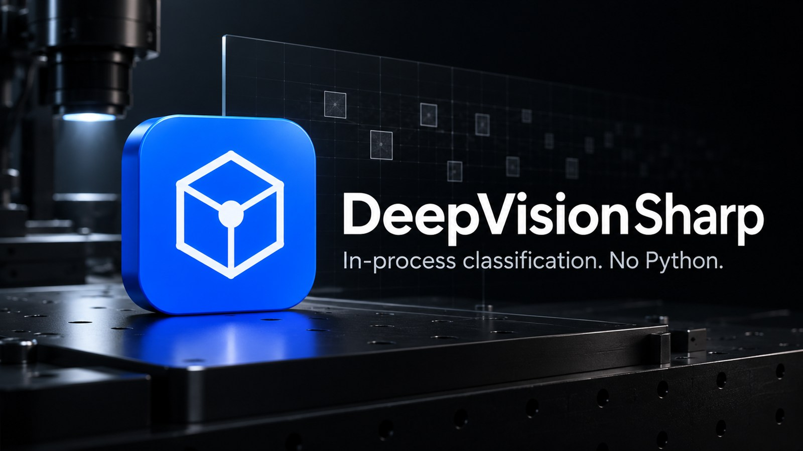
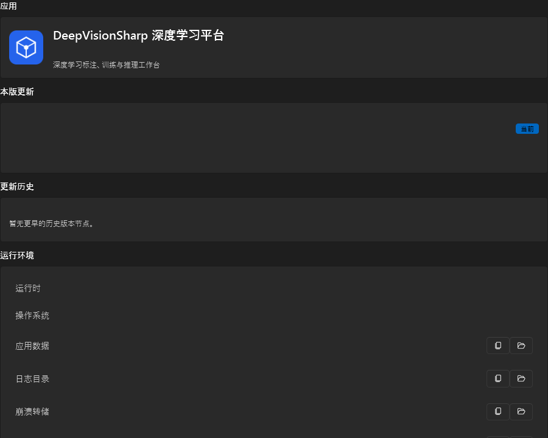
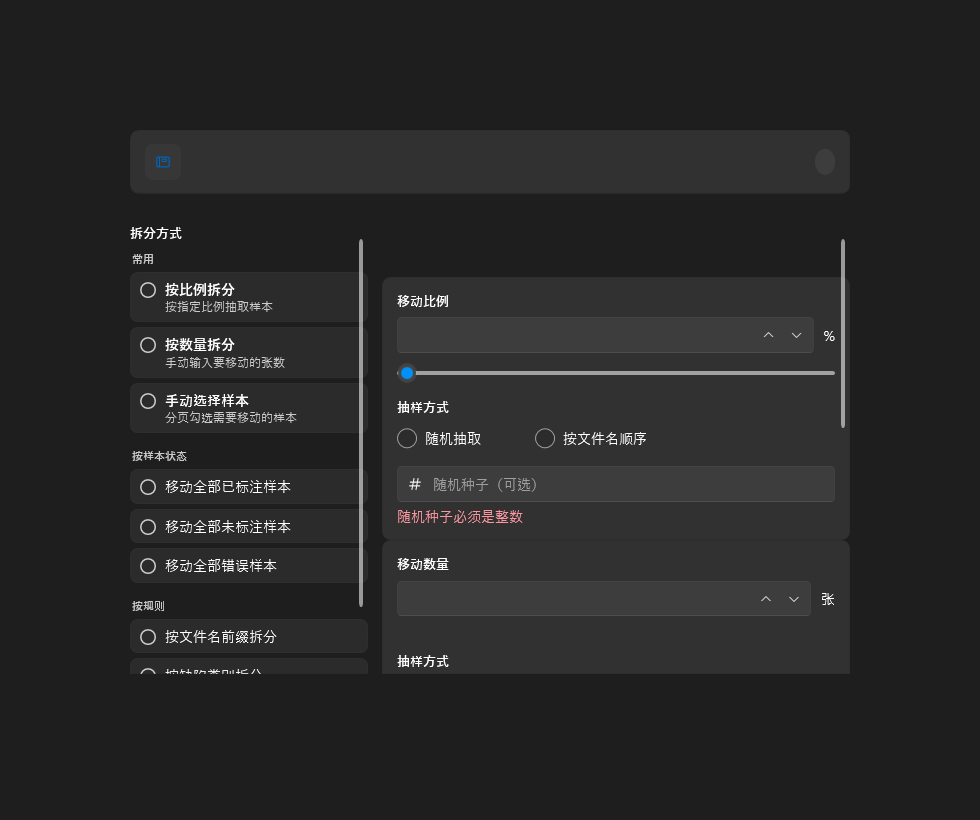
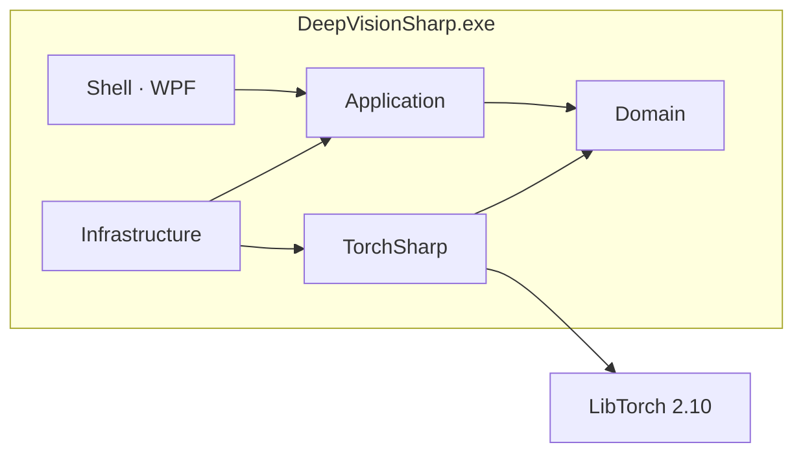

<p align="center">
  
</p>

<h1 align="center">DeepVisionSharp</h1>

<p align="center">
  <strong>进程内图像分类工作台。</strong> 标注、训练、推理都在一个 WPF 进程里完成，不启动 Python。
</p>

<p align="center">
  <a href="LICENSE"></a>
  
  
  
</p>

<p align="center">
  
</p>

把分类模型关进桌面应用。一批图、几个类，在本机训完立刻推理；数据不出机，也不把训练外包给 conda。

当前只做**整图分类**。检测、分割、异常检测不在范围内。

## 立场

| 原则 | 落地 |
| --- | --- |
| 一个进程 | TorchSharp 0.107 + LibTorch 2.10 跑在 WPF 宿主里。没有 sidecar，没有 Ultralytics CLI。 |
| 本机优先 | SQLite、图库、权重、日志都在 `%LOCALAPPDATA%\\DeepVisionSharp`。运行时不上报遥测。 |
| 现场能装 | 自包含安装包，默认用户目录，不需要管理员，也不捆绑 Python。 |
| 分类做透 | ResNet-Tiny / 18 / 34（torchvision 兼容）。SGD / Adam / AdamW。缺预训练权重就从随机初始化开训。 |

<p align="center">
  
</p>

## 工作流

```text
项目 → 图库 → 整图标注 → 导出分类数据集 → 进程内训练 → 模型库 → 单图 / 批量推理
```

训练在后台跑；准备或运行期间不能删除该项目。标注 sidecar 用完整图片名（`sample.jpg.json`），旧的 `sample.json` 仍可读。

<p align="center">
  
</p>

## 从源码运行

Windows x64 + [.NET 10 SDK](https://dotnet.microsoft.com/download)。GPU 训练 / 推理需要本机 NVIDIA 驱动。

```powershell
git clone git@github.com:ziyuhaokun/deepvisionsharp.git
cd deepvisionsharp
dotnet run --project src/DeepVisionSharp.Shell/DeepVisionSharp.Shell.csproj
```

可选，拉 torchvision 预训练权重（仅转换脚本需要 Python 3 + numpy）：

```powershell
.\scripts\fetch_pretrained.ps1 -Arch resnet18
```

权重写到 `%LOCALAPPDATA%\\DeepVisionSharp\\Models\\pretrained`，也可用 `DV_PRETRAINED_ROOT` 指定目录。

自包含安装包：

```powershell
.\scripts\build_installer.ps1
```

产物 `scripts/Output/DeepVisionSharp-{version}-x64.exe`，默认装到 `%LocalAppData%\\DeepVisionSharp`。细节见 [packaging/README.md](packaging/README.md)。

## 架构



产品 solution：`DeepVisionSharp.slnx`（6 个 project）。安装器工具在 `packaging/installer/Installer.slnx`，不进产品 solution。

| Project | 职责 |
| --- | --- |
| `Shell` | WPF 主程序，`DeepVisionSharp.exe` |
| `Application` | CQRS、校验、Ports |
| `Domain` | 实体与值对象 |
| `Infrastructure` | SQLite、训练 / 推理调度 |
| `TorchSharp` | 进程内训练与推理 |
| `Bootstrap` | 依赖注入装配 |

## 隐私

运行时不外发。图库、模型、日志、minidump 都在本机 `%LOCALAPPDATA%\DeepVisionSharp`。把日志或 dump 拷走时，其中可能含样本路径。DEBUG 维护入口读取环境变量 `DEEPVISIONSHARP_DEBUG_PASSWORD`，仓库里没有默认密码。

## 许可

[MIT](LICENSE)。TorchSharp、LibTorch、OpenCvSharp 遵循各自许可证。`scripts/fetch_pretrained.ps1` 下载的 torchvision 权重遵循上游条款。

**0.0.1** · 2026-10-16 · [用户版变更](CHANGELOG.md) · [开发者变更](CHANGELOG.Developer.md)
